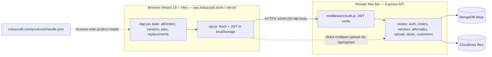
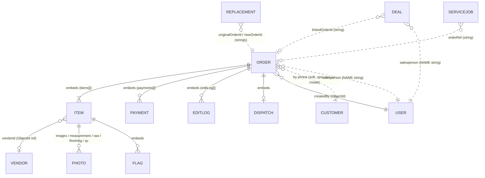
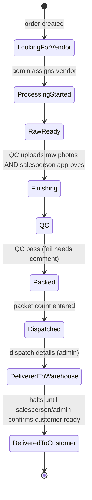
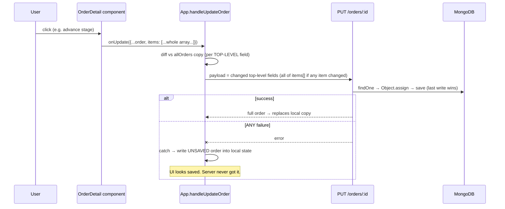

# Induscraft OMS — Architecture, Findings & Redesign Plan

**Snapshot reviewed:** `induscraft-backend` @ `a077f64`, `induscraft-oms` @ `6be1cc1` (both `main`, cloned 8 Oct 2026).
**Purpose:** one reference for how the OMS actually fits together, where it breaks, and how to rebuild the weak parts without a rewrite.

---

## 0. How to read this document

**Severity tags** (used consistently throughout):

| Tag | Meaning |
|---|---|
| `[BROKEN]` | Actively losing data or behaving wrongly today. Reproduced or directly visible in code. |
| `[EXPOSED]` | A security exposure that exists today. |
| `[GAP]` | Worth knowing; not currently biting, or only under conditions. |
| `[DECISION]` | A policy question for the owners. Not a bug. Nothing should be "fixed" until decided. |

**Evidence tags:**

| Tag | Meaning |
|---|---|
| **Executed** | I ran the real code or a verbatim replica of the logic and observed the result. |
| **Code** | Read directly in the repo; behaviour follows from the source. |
| **Inference** | Plausible from the code and hosting setup, but not confirmed against production. |

**What this document is not:** it is based on the two GitHub repos and the project notes. I have no access to production logs, the Render/Vercel dashboards, or live data, so anything depending on those is marked **Inference** or listed in §16.

---

## 1. Executive summary

### The core problem: the app tells users data is saved when it is not

The single most important finding. In `App.jsx`, every write handler **swallows failures and writes the unsaved data into local state anyway**:

- `handleUpdateOrder` catch block → `setAllOrders(... orderToSave)`
- `handleNewOrder` catch block → "Fallback: add locally", then navigates to the order as if created
- `handleAddVendor` / `handleAddVendors` → same pattern

So any failed request (cold-started server, network blip, 4xx/5xx, oversize body, duplicate ID) looks like success on screen and disappears on the next refresh or login. Worse, because the diff baseline (`allOrders`) now already contains the failed change, **later saves never re-send it** (Executed, scenario A in §9).

This is almost certainly what "orders are not getting saved properly" feels like from the floor. What *triggers* the failures in production needs log confirmation (§16), but the code guarantees the failures are invisible.

### Findings at a glance

| # | Tag | Finding | Evidence |
|---|---|---|---|
| F1 | `[BROKEN]` | Failed saves are shown as successful; failed edits are permanently lost after the next successful save | Executed |
| F2 | `[BROKEN]` | New-order create failure: order appears created, draft is already deleted from localStorage, refresh loses the whole order | Code |
| F3 | `[BROKEN]` | Selecting several photos at once saves only one | Executed |
| F4 | `[BROKEN]` | Finishing an image upload silently reverts any stage change made on *any item* while the upload was in flight | Executed |
| F5 | `[BROKEN]` | After-sales jobs and replacements are never saved — local React state only | Code |
| F6 | `[BROKEN]` | "Advance paid" / "Balance due" on Order info never reflect logged payments | Code |
| F7 | `[BROKEN]` | Every payment is recorded as `by: "Current user"` — audit trail is useless | Code |
| F8 | `[BROKEN]` | Base64 image previews are persisted into MongoDB before the Cloudinary swap; three phone photos exceed MongoDB's 16 MB document limit and the save throws | Executed |
| F9 | `[GAP]` | Order ID is allocated when the form opens, not when it saves → duplicate-ID collisions between concurrent creators | Code |
| F10 | `[GAP]` | All orders loaded once at login, never refreshed (30-day tokens ⇒ very stale tabs) | Code |
| F11 | `[GAP]` | No request timeout/retry; non-JSON responses (cold-start 502/503, proxy 413) throw into the F1 fallback | Code + Inference |
| F12 | `[EXPOSED]` | `vendorCost` and all fields returned to every role; `PUT /orders/:id` has no role check (known gaps #1, #2) | Code |
| F13 | `[EXPOSED]` | Seed route is unauthenticated and the seeded default credentials are in a **public** repo | Code |
| F14 | `[GAP]` | Dedicated PATCH routes can't be used as-is: they look items up by Mongo `_id`, the frontend identifies items by its own `id` | Executed |
| F15 | `[GAP]` | Repo hygiene: frontend `.gitignore` is UTF-16 so git ignores it → 2,264 `node_modules` files committed; stale nested duplicate app folder; `dist/` committed | Executed |
| F16 | `[DECISION]` | Margin-override authority, dedicated-PATCH vs generic-PUT direction, dispatch per item, etc. (§13) | — |

### The recommendation in one paragraph

Don't rewrite. Fix honesty first (stop pretending saves worked — frontend-only, small, huge impact), then replace the "send the whole order" PUT with small, named, role-checked operations that the server applies atomically. That one change closes F1, F3, F4, F6, F7, F12 and the "two people editing" class of bugs together, and it's the same work that finally gives you real role enforcement. Details in §14–15.

---

## 2. System overview



| Layer | Tech | Notes |
|---|---|---|
| Frontend | React 18, Vite, inline styles, no router, no state library | Hosted on Vercel; auto-deploy on push to `main` |
| Backend | Node ≥18, Express 4, Mongoose 8.24 | Render free tier — **sleeps after ~15 min idle** (30–60 s cold start) |
| Database | MongoDB Atlas | Orders are single large documents |
| Files | Cloudinary via multer memory storage | 20 MB per file, images + PDF |
| Auth | JWT (30-day expiry), bcrypt hashes | Token in `localStorage` |
| Email | None (removed) | `utils/email.js` still present in repo but unused |

**Request path for a typical save today:** user clicks a button in `OrderDetail` → component builds a *full copy of the order* with one field changed → `onUpdate` → `App.handleUpdateOrder` diffs against its cached copy → `PUT /api/orders/:id` → route does `findOne` + `Object.assign` + `save` → returns the whole order → UI replaces its copy.

### Code size

| Area | Lines | Note |
|---|---|---|
| Backend (excl. lockfile) | ~1,450 | `routes/orders.js` is the centre of gravity (352) |
| Frontend `src/` | ~6,500 | `OrderDetail.jsx` alone is 1,735 (27%); 8 components live in it |

---

## 3. Repository inventory & hygiene

### Backend (`induscraft-backend`)

```
server.js            Express bootstrap, CORS, route mounting, 2 temp migration endpoints
middleware/auth.js   JWT → req.user {id, role, name}
routes/auth.js       login, users CRUD (admin), me, seed
routes/orders.js     order CRUD + 6 PATCH sub-routes + next-id
routes/vendors.js    list/get/create/bulk/update
routes/aftersales.js service jobs + replacements
routes/upload.js     Cloudinary upload (single/multiple), delete
routes/deals.js      sales pipeline CRUD + activity log
routes/customers.js  phone lookup + upsert
models/*.js          Order, User, Vendor, Deal, Customer, AfterSales(ServiceJob, Replacement)
utils/email.js       DEAD — requires nodemailer which is no longer a dependency
scripts/migrateImages.js  one-off
```

### Frontend (`induscraft-oms/src`)

```
App.jsx          shell, login, global data + all write handlers
api.js           fetch wrapper + 37 endpoint functions (14 unused — see §5)
data.js          CHANNELS, STAGES, ROLES
ui.jsx           shared components, stage timers, status helpers
Dashboard.jsx / OrdersList.jsx / PastOrders.jsx / Settings.jsx / CostApproval.jsx
NewOrderForm.jsx (922)   5-step creation, localStorage draft, Shopify loader
OrderDetail.jsx (1735)   OrderInfoTab, LineItemsTab, TrackerTab, VendorsTab, PaymentsTab,
                         EditOrderModal, DeleteOrderModal, VendorAssign, EditLogPanel
PrintView.jsx            4 print types
Sections.jsx (822)       VendorsSection, AfterSales, Reports  (+3 one-line re-export files)
Pipeline.jsx (679)       CRM table/kanban, deal modal, stats
```

### Hygiene findings

| Tag | Finding | Evidence |
|---|---|---|
| `[GAP]` | Frontend `.gitignore` is UTF-16 encoded, which git can't parse. Result: `node_modules` (2,264 files) and `dist/` are committed. | Executed (`file .gitignore`, `git ls-files`) |
| `[GAP]` | `induscraft-oms/induscraft-oms/` — a stale, older copy of the whole app (16 tracked files) sits inside the repo. Not built, but confusing. | Executed |
| `[GAP]` | `utils/email.js` still in backend repo though notes say deleted. | Executed |
| `[GAP]` | `api.js` default API URL is a `railway.app` host, but the backend is on Render. Correct only if `VITE_API_URL` is set in Vercel — if it's ever unset, every call goes to a dead host. | Code |
| `[GAP]` | Backend CORS allowlist in the repo contains `oms.induscraft.com` but **not** `ops.induscraft.store` (the live domain per the notes). Either the deployed code differs from GitHub, or the notes are ahead of the repo. Needs checking against what Render is running. | Code — see §16 |
| `[GAP]` | Two temp endpoints (`/api/migrate-deal-stages`, `/api/fix-sanskar`) remain, guarded by a secret that is hard-coded in the public repo. | Code |

---

## 4. Data model



Solid lines are real embeds/refs. **Dotted lines are string matches with no integrity** — the weakest links in the system.

### Collections

| Collection | Key fields | Notes |
|---|---|---|
| `orders` | `id` (e.g. `BL-0001`, unique), `channel`, `customer{name,phone,address}`, `value`, `advance`, `status` (active/archived), `deliveryConfirmed`, `costApproved`, `marginOverride`, `costs` (Map), `dispatchDetails`, `items[]`, `payments[]`, `editLog[]` | **One document holds everything.** Every photo URL, payment, stage history and log lives here → document grows with the order and every write contends on it. |
| `orders.items[]` | `id` (custom string, e.g. `i_BL-0001_0`), `_id` (Mongo), `stageIndex` 0–8, `stageHistory[]`, `vendorId`, `vendorCost`, 5 photo arrays, `finishingProgress` (Map), `qcStatus/qcNotes`, `packetCount`, `rawPhotosApproved`, `flags[]`, dates | Two identifiers per item (`id` and `_id`) — the root of F14. |
| `vendors` | name, phone, contact, location, email, notes | `orders.items[].vendorId` → vendor `_id` |
| `deals` | customer*, channel, stage (6), `salesperson` (name), `linkedOrderId`, `logs[]` | Ownership is by **display-name string**; the `fix-sanskar` hotfix existed because "Sanskar" ≠ "Sanskar Jain". |
| `customers` | `phone` (unique, normalized 10 digits), name, address, `lastOrderId` | Upserted fire-and-forget on order create (`.catch(() => {})`). |
| `users` | username, bcrypt password, name, initials, role | Roles: admin / sales / qc / accountant |
| `servicejobs`, `replacements` | see `models/AfterSales.js` | Backend works; **frontend never calls it** (F5). |

### Integrity risks inherent in the model

1. `order.salesperson` and `deal.salesperson` are free-text names, matched against `req.user.name`/`currentUser.name`. Renaming a user orphans their orders' "responsible salesperson" rights.
2. `ORDER.value` and `ITEM.price` are denormalized; `value` is computed once at creation and edited manually afterward.
3. `ORDER.advance` is denormalized from `payments[]` and **not maintained** by the path the UI uses (F6).
4. Photo arrays accept raw base64 in the `data` field (the schema allows it) — enabling F8.

---

## 5. API surface

`Used by UI` is based on searching the frontend for each call.

### Orders

| Route | Role gate (server) | Used by UI | Notes |
|---|---|---|---|
| `GET /orders/next-id?channel=` | any | yes (form step 1) | `find` + `Math.max` → not atomic (F9) |
| `GET /orders` | any | yes (login) | Returns **full documents, all roles, all orders, incl. archived** |
| `GET /orders/:id` | any | no | Same exposure |
| `POST /orders` | admin, sales | yes | Spreads `req.body` straight into the model |
| `PUT /orders/:id` | **none** | yes — ~24 call sites | Whole-field overwrite via `Object.assign`; also does rename + edit-log append |
| `DELETE /orders/:id` | admin | yes | Also deletes Cloudinary files |
| `PATCH /:id/item/:itemId/stage` | any | **no** | Looks up `items.id(itemId)` → expects Mongo `_id` |
| `PATCH /:id/item/:itemId/vendor` | admin | **no** | Same |
| `PATCH /:id/item/:itemId/flag` | any | **no** | Same |
| `PATCH /:id/item/:itemId/delay` | admin | **no** | Same |
| `PATCH /:id/payment` | admin, sales, accountant | **no** | The only route that recomputes `advance` |
| `PATCH /:id/dispatch` | admin | **no** | |

### Everything else

| Route | Role gate | Used by UI |
|---|---|---|
| `POST /auth/login` | public | yes |
| `GET /auth/users` | any | yes (dropdowns) |
| `POST/PUT/DELETE /auth/users…` | admin | yes (Settings) |
| `GET /auth/me` | any | no |
| `POST /auth/seed` | **public** | no — see F13 |
| *(none)* `POST /auth/change-password` | — | `api.changePassword` calls a route that doesn't exist (dead) |
| `GET/POST /vendors`, `POST /vendors/bulk` | read any; write admin | yes |
| `PUT /vendors/:id` | admin | no (no vendor-edit UI) |
| `GET/POST /aftersales/jobs`, `/replacements` | any | **GET only** |
| `PATCH /aftersales/jobs/:id/status`, `/replacements/:id` | admin | **no** |
| `POST /upload/image`, `/multiple` | any | image only |
| `DELETE /upload/:publicId` | admin | no |
| `GET/POST/PATCH/DELETE /deals…` | owner/admin | yes |
| `GET /customers?phone=`, `POST /customers/upsert` | any | lookup yes |

**Pattern:** the backend has a reasonable fine-grained API (stage, vendor, payment, dispatch, after-sales) that the frontend ignores in favour of one generic PUT. 14 of the 37 functions in `api.js` are never called.

---

## 6. Frontend map — screens → data → writes

| Screen | Reads | Writes (how) | Role access |
|---|---|---|---|
| Login | — | `login` | all |
| Dashboard | `allOrders` (in memory) | none | all |
| Orders list | `allOrders` | create → `handleNewOrder` (POST) | all; creating needs admin/sales |
| New order (5 steps) | `next-id`, `customers?phone`, `auth/users`, Shopify JSON | `POST /orders` + `POST /upload/image` per file | admin, sales |
| Order detail → **Order info** | order | whole-order PUT | all |
| → **Line items** | order | PUT + Cloudinary upload (photos) | **any role** may edit images |
| → **Order tracker** | order, vendors | PUT (stage, QC, raw approval, packets, dispatch, delay) | admin all; sales ≥ stage 7; QC stages 4–5 |
| → **Vendors & production** | order, vendors | none | admin, QC |
| → **Payments** | order | PUT (appends to `payments[]`) | admin, sales, accountant |
| → **Costs** | order | PUT (`costs`, `costApproved`, `marginOverride`) | admin |
| Vendors | vendors, orders | `createVendor`, `importVendors` (fallback to local on failure — F1) | admin |
| After-sales | props → **local `useState`** | **nothing persisted** (F5) | admin |
| Reports | orders | none (export cards are placeholders) | admin, accountant |
| Past orders | orders | restore → PUT | admin, sales, accountant |
| Pipeline | `GET /deals` (own fetch, own state) | deal APIs; "Won" → prefill → New order | admin, sales |
| Settings | `GET /auth/users` | user CRUD | admin |

**Two data-flow styles coexist:** orders/vendors/jobs go through `App.jsx` global state loaded once at login; Pipeline and Settings fetch their own data per mount. There is no shared cache, no invalidation, and no router — a browser refresh drops you back on the Dashboard with the order closed.

---

## 7. Order lifecycle & business rules

### Stages (tracked **per item**, 0–8)



An order's headline stage is the **maximum** of its items' stages (`OrderDetail` header). `stageHistory[]` feeds the SLA timers in `ui.jsx`.

### Where each rule is enforced

| Rule | UI | Server |
|---|---|---|
| Vendor required to leave stage 0 | yes | **no** (only inside the unused PATCH vendor route) |
| Raw photos + salesperson approval before Finishing | yes | **no** |
| QC pass/fail; fail requires a comment | yes | **no** |
| Packet count at Packed | yes | **no** |
| Customer-ready gate at warehouse | yes | **no** |
| Who may advance which stage (`canAdvance`) | yes | **no** (`PUT` has no role check) |
| 30% minimum margin / override | yes (`CostApproval`) | **no** |
| Only responsible salesperson/admin can WhatsApp the customer | yes | n/a |
| Delivery date: salesperson proposes, admin confirms | yes | **no** |
| Past Orders: all items delivered **and** ≥10 days since latest delivery date (deliberate grace window) | `ui.isPastOrder` | n/a |

> **Every business rule lives only in the browser.** Anyone with a valid login who can call the API can bypass all of them. That is the architectural reason known gap #2 can't be fixed with a route-level role check: the rules aren't modelled on the server at all.

Order IDs: `BL / PU / JD / WB / WS` + 4-digit sequence, editable at creation. 

---

## 8. Roles & permissions — intended vs enforced

| Capability | Admin | Sales | QC | Accountant | Enforced on server? |
|---|---|---|---|---|---|
| See vendor **cost** | ✔ | ✘ intended | ✘ intended | ✔ | **No** — sent to everyone (F12) |
| See vendor name/phone | ✔ | ✘ | ✔ | ✘ | **No** — sent to everyone |
| Create order | ✔ | ✔ | ✘ | ✘ | Yes |
| Advance stages | all | ≥ 7 | 4–5 | ✘ | **No** |
| Assign vendor / approve cost / override margin | ✔ | ✘ | ✘ | ✘ | **No** (override is Admin-wide, §13) |
| Log payments | ✔ | ✔ | ✘ | ✔ | **No** via the route the UI uses |
| Edit product images | ✔ | ✔ | ✔ | ✔ | by design ("any role") |
| Archive / restore | ✔ | restore in Past Orders | ✘ | restore in Past Orders | **No** |
| Delete order | ✔ | ✘ | ✘ | ✘ | **Yes** |
| User management | ✔ | ✘ | ✘ | ✘ | Yes |

Only deletion, user management, order creation, vendor CRUD and the unused PATCH routes are actually protected server-side. Everything the UI does to an existing order is effectively unprotected.

---

## 9. The save path — why data is lost (core analysis)

### 9.1 Current flow



### 9.2 Failure modes, each reproduced or traced

#### F1 `[BROKEN]` Failed saves look successful and are then lost forever — **Executed**

I copied `diffOrderFields` and `handleUpdateOrder` verbatim and ran them against a simulated server using the real `Object.assign` semantics:

```
A1 UI shows notes   : "Customer wants walnut finish"
A1 server has notes : ""          <- not saved, UI says otherwise
A2 after later save, server notes: "" | status: archived
A2 => failed edit is now PERMANENTLY lost
```

Mechanism: the catch block puts the unsaved order into `allOrders`; `allOrders` is also the diff baseline; so on the *next* save the unsaved field already equals the baseline and is omitted from the payload. The failure is not just hidden, it becomes unrecoverable without re-typing.

Likely triggers (**Inference**, confirm in Render logs): cold-start 502/503 returning HTML (so `res.json()` throws), a request exceeding the body limit, a version conflict after three retries, a duplicate order ID (409/500), network drop on mobile.

#### F2 `[BROKEN]` New-order creation can vanish entirely — **Code**

`NewOrderForm.handleSave` calls `clearDraftOnSave()` (deletes the localStorage draft) **then** `onSave(newOrder)`. If `POST /orders` fails, `handleNewOrder` adds the order to local state and navigates to it. The user sees a created order; the draft is already gone; on refresh the order does not exist anywhere. Five steps of data entry, no recovery.

#### F3 `[BROKEN]` Multi-photo selection keeps one photo — **Executed**

`LineItemsTab.handleFileSelect` loops over the selected files; each `reader.onload` builds from the **same captured `order` prop**, so each save replaces the previous one's preview and every upload completion rewrites the same array index:

```
B  photos selected: 3 | photos on server: c.jpg(url)
```

#### F4 `[BROKEN]` Upload completion reverts unrelated changes — **Executed**

The "swap preview for Cloudinary URL" save is built from a snapshot taken when the upload *started*. Because `items` is diffed as one unit, the whole stale `items[]` is sent:

```
C1 Sofa stage on server after advance: 2
C2 Sofa stage on server after upload completes: 1   <- advance silently reverted
```

This is **single-user**, not a multi-admin race, so it happens in normal use whenever someone advances any item while a photo is uploading. The notes' "known residual limitation" (per-field diff granularity) is real but understates it: it bites within one session.

#### F8 `[BROKEN]` Base64 previews are persisted, then can break the order — **Executed**

Both `NewOrderForm` and `LineItemsTab` save a base64 preview (`data:`) first and swap in the Cloudinary URL afterward; on upload failure the base64 stays as the "fallback". The photo schema accepts `data`. MongoDB documents cap at 16 MB:

```
1 phone photo  (4 MB raw)   5.3 MB  ok
2 phone photos (4 MB raw)  10.7 MB  ok
3 phone photos (4 MB raw)  16.0 MB  EXCEEDS 16 MB — save throws
```

An order with three unfinished uploads can become unsaveable, and every failure then flows into F1. (The `uploading: true` flag is not in the schema, so it's silently stripped — the persisted preview looks like a finished image.)

#### F6 / F7 `[BROKEN]` Payments — **Code**

- `PaymentsTab.addPayment` appends to `payments[]` and PUTs. It never touches `advance`. `OrderInfoTab` shows `order.advance` and `value − advance`; `advance` is `0` at creation and only the unused `PATCH /payment` route recomputes it. So **Order info always shows ₹0 advance and full balance due**, while the Payments tab (which sums `payments[]`) shows the truth.
- The payment record is hard-coded `by: "Current user"` instead of the logged-in name.
- Two people logging payments at the same moment: whole `payments[]` array is last-write-wins → one payment lost.

#### F5 `[BROKEN]` After-sales isn't persisted — **Code**

`Sections.jsx` does not import `api`. `saveJob`, `updateJobStatus`, `saveReplacement` only call `setAllJobs/setAllReplacements`. Records live until refresh. (The project notes say after-sales routes were "confirmed correctly persisting" — true of the *backend* routes; nothing in the UI calls them.) Also `AfterSales` seeds state with `useState(initialJobs)`, so it ignores later prop updates, and the search filter calls `j.orderRef.toLowerCase()` which throws if a saved job has no `orderRef`.

#### F9 `[GAP]` Order IDs collide — **Code**

`fetchNextOrderId` runs on form step 1; the ID is only used at save time minutes later. `GET /next-id` reads all IDs and takes `max + 1` — two people creating in the same channel get the same ID; the second `POST` hits the unique index and fails → F2. Also allocation is a table scan per call.

#### F14 `[GAP]` The existing PATCH routes can't just be switched on — **Executed**

```
items.id("i_BL-0001_0")  -> null      (frontend's item id)
items.id("64b0…0002")    -> Bed       (Mongo _id)
```

`order.items.id()` only matches `_id`. Migrating the frontend to those routes with `item.id` returns 404 "Item not found". The routes also don't implement the gates in §7, so they are a starting point, not a drop-in.

### 9.3 Why the earlier fixes didn't resolve it

The notes document three real fixes (item `id` in schema, stale-snapshot diff, Cloudinary cleanup) and one corrected misdiagnosis (`markModified`). Those addressed *symptoms of the same architecture*: a client that ships whole documents and a server that overwrites them. Each patch narrows one window; the underlying shape (whole-document writes + client-held truth + silent failure) keeps producing new ones — F3 and F4 are the same family as the bug fixed last session.

---

## 10. Sync, freshness & performance

| Tag | Issue | Evidence |
|---|---|---|
| `[GAP]` F10 | `loadAllData()` runs once on login/mount. No polling, no refetch on focus, no per-order refresh. Tokens last 30 days and the user is restored from `localStorage`, so a tab can sit on days-old data. | Code |
| `[GAP]` | `GET /orders` returns every order incl. archived, with all photo arrays, to every role. Payload grows without bound; no pagination, no summary projection. | Code |
| `[GAP]` F11 | `apiFetch` has no timeout, no retry, no handling of non-JSON bodies (`res.json()` throws), and a 401 triggers a hard `window.location.reload()` that discards any in-progress form state (except the new-order draft). | Code |
| `[GAP]` | Render free tier: first request after ~15 min idle takes 30–60 s, with no "server waking up" indicator — users click again, creating duplicate submissions or aborting. | Code + Inference |
| `[GAP]` | No router: refresh/back button lose position; deep links to an order are impossible; selection lives in component state. | Code |
| `[GAP]` | `POST /orders` customer upsert and the edit log are fire-and-forget / best-effort; failures are swallowed. | Code |

---

## 11. Feature wiring gaps

| Area | State |
|---|---|
| After-sales create/status | UI only, never saved (F5) |
| Order info advance/balance | Stale (F6) |
| Payment attribution | Literal "Current user" (F7) |
| `api.changePassword` | Calls nonexistent route; password changes happen via Settings → `updateUser` |
| Reports exports | 6 export cards are placeholders |
| Vendor edit | Backend route exists, no UI |
| Dispatch | Order-level only; items in one order can't dispatch separately (acknowledged in code comments) |
| Flags | PATCH route exists, no UI usage found |
| `uploadMultipleFiles`, `fetchOrder`, `fetchOrders` | Unused |

---

## 12. Security & access

| Tag | Finding |
|---|---|
| `[EXPOSED]` F12 | Any logged-in user, via the browser network tab, can read `vendorCost` for every order, and can send a `PUT` that changes `status`, `costApproved`, `marginOverride`, `dispatchDetails`, vendor assignment and costs. (Known gaps #1/#2 — confirmed in code.) `POST /orders` and `PATCH /deals/:id` also spread raw request bodies into the model (mass-assignment). |
| `[EXPOSED]` F13 | `POST /api/auth/seed` needs no auth and the seeded usernames/passwords are written in `routes/auth.js` in a **public** GitHub repo. The route only creates *missing* users, but anyone can recreate a deleted account with its default password, and **any account still on its seeded password is effectively public**. Whether that applies depends on whether those passwords were changed — please confirm (§13). |
| `[EXPOSED]` | Project notes kept alongside this work contain live credentials/secrets in plain text. Treat any of them as compromised if the notes are shared; rotate and remove from notes. |
| `[GAP]` | Hard-coded migration secret in the public repo guards two mutating `GET` endpoints (deal data only). Remove the endpoints. |
| `[GAP]` | 30-day tokens, no revocation; role is baked into the token (a demoted user keeps their old role until expiry). |
| `[GAP]` | Salesperson ownership by display name. |
| `[GAP]` | Atlas free tier has no continuous backup — confirm backups/export exist for a system holding all orders. |

---

## 13. Decisions needed (not bugs)

Per your working rules these are flagged for a decision, not fixed.

1. **Margin-override authority** — currently any of the 5 admins. Intentional, or should it be specific people?
2. **Direction for the order-write API** — retire the generic PUT (recommended, §14) or keep it and add field allowlists. This is the biggest architectural choice.
3. **Vendor visibility** — confirm: Sales never sees vendor name *or* cost; QC sees vendor name/phone but no cost; Accountant sees cost but not vendor identity? (Today's intent is inferred from notes.)
4. **Dispatch granularity** — per order (today) or per item/shipment?
5. **Responsible-salesperson identity** — move from name strings to user IDs (needs fallback logic for existing orders).
6. **Any role may edit product images** — keep?
7. **Archive vs delete** — who can archive; should Sales/Accountant keep "restore"?
8. **Default passwords** — were all ten seeded passwords changed? If not, that's the first thing to do today, before any of the engineering below.
9. **Hosting** — move the API off the sleeping free tier (paid Render instance) or add a keep-alive ping? Paid is the cleaner fix.
10. **Past Orders grace window** — stays 10 days (documented as intentional).

---

## 14. Target architecture (redesign)

### 14.1 Principles

1. **The server is the source of truth.** The UI never displays unsaved data as saved. Every write has a visible state: *saving → saved* or *failed + retry*.
2. **Write the smallest unit.** Each mutation is a named operation on one item/field, applied atomically with Mongo operators (`$set`, `$push`, `$inc` with `arrayFilters`) — no read-modify-write of the whole document.
3. **Rules live on the server.** Gates (§7) and role checks are enforced in one policy layer; the UI mirrors them for display only.
4. **Files never go through the database.** Upload to Cloudinary first, save the URL once. No base64 in MongoDB, ever.
5. **Different shapes for reading and writing.** Slim list payload, full role-projected detail payload.
6. **Evolve in place.** Old and new paths coexist during migration, using fallback logic rather than data migrations (per your preference).

### 14.2 Operation-based order API

Replace "PUT the whole order" with these (each does auth → validate → atomic update → append edit-log in the *same* update → return the updated order, role-projected):

| Operation | Replaces | Server-enforced rules |
|---|---|---|
| `POST /orders` | create | server allocates ID atomically (§14.4); idempotency key to make retries safe |
| `PATCH /orders/:id/info` | Edit modal | field allowlist (customer, notes, date, salesperson, value); version check |
| `POST /orders/:id/items/:itemId/advance` | tracker buttons | stage gates (§7), `canAdvance(role, stage)`, pushes `stageHistory` |
| `POST /orders/:id/items/:itemId/revert` | stage dropdown | admin-only/limited; clears per-stage data |
| `PUT /orders/:id/items/:itemId/vendor` | VendorAssign | admin |
| `POST /orders/:id/items/:itemId/qc` | QC pass/fail | QC/admin; fail requires comment |
| `POST /orders/:id/items/:itemId/photos` / `DELETE …/photos/:photoId` | image/photo handling | URL only (no `data`); `$push`/`$pull` so concurrent uploads can't clobber |
| `POST /orders/:id/items/:itemId/approve-raw` | raw approval | responsible salesperson/admin |
| `PUT /orders/:id/delivery` | delivery date confirm/delay | salesperson proposes, admin confirms |
| `POST /orders/:id/payments` | PaymentsTab | `$push` payment **and** `$inc advance` in one update; `by` from `req.user` |
| `PUT /orders/:id/costs` | CostApproval | admin; margin rule + override recorded server-side |
| `PUT /orders/:id/dispatch` | dispatch | admin |
| `POST /orders/:id/archive` / `restore` | status changes | role per §13 |
| `GET /orders` | list | **summary projection** (no photos, no costs), filters, `since=` for cheap refresh |
| `GET /orders/:id` | detail | full, **projected by role** (strips `vendorCost`, vendor identity, costs as policy dictates) |

All item routes accept the frontend's `id` **or** the Mongo `_id` (fallback lookup), which resolves F14 without touching old data.

**Policy as data:** one small table (`role × operation × stage-condition`) that the route layer reads and that is exported as JSON for the UI to use for show/hide. This makes known gaps #1 and #2 a by-product, not a separate project.

### 14.3 Concurrency & integrity

- Add an integer `rev` to orders, incremented on every write. Operations where a stale view is dangerous (info edits, costs) send the `rev` they saw; the server answers **409 + current order** on mismatch and the UI shows "Someone else changed this — review and reapply".
- Atomic item/array operators make item-level edits independent: two people editing different items, or logging payments, no longer interfere (closes the notes' "residual limitation").
- Replace string joins over time: `salesperson` → user id (with name fallback), `Deal.linkedOrderId` stays a string but validated.

### 14.4 Order-ID allocation

A `counters` collection (`{_id: "BL", seq}`) incremented with `findOneAndUpdate({$inc})` **at save time**. First use per channel seeds from the current max of existing IDs (fallback logic, no migration script). The form shows a *suggested* ID; if you override it the unique index still protects you, and a clash returns a clear message instead of F2.

### 14.5 Files

Browser uploads the file → gets `{url, publicId}` → *then* the item save references the URL. Each file is its own atomic `$push`. Selecting N files works naturally (F3), uploads can't revert stages (F4), and the 16 MB limit stops being reachable (F8). Failed uploads show a retry button on the thumbnail; nothing is stored until the upload succeeds. Optional later: signed direct-to-Cloudinary uploads so images don't pass through the Render instance at all.

### 14.6 Frontend structure

```
src/
  api/            client.js (timeout, retry on GET, JSON-safe, 401 handling, request ids)
                  orders.js … one file per resource, typed ops
  data/           query layer (TanStack Query or a small equivalent):
                  per-resource cache, refetch on focus + interval, mutations with
                  explicit saving/saved/failed state, invalidate-on-409
  policy/         can(role, action, order) + stage rules, shared with the server's table
  routes/         react-router: /orders, /orders/:id/:tab, /pipeline, … (deep links, back button)
  features/orders/ OrderInfoTab, LineItemsTab, TrackerTab, PaymentsTab, CostsTab … one file each
  components/     existing ui.jsx pieces, split
```

- **Delete every `catch → setState(local)`**. Replace with a global save-status indicator (e.g. "Saving…" / "All changes saved" / red "Not saved — retry"), plus toasts for failures.
- **Block navigation / disable buttons while a save or upload is pending**, so F3/F4-style overlaps can't start.
- **Keep the new-order draft until the server confirms creation.**
- "Server waking up…" banner when a request exceeds ~3 s.
- Split `OrderDetail.jsx` (1,735 lines) along its existing component seams — no behaviour change, makes everything else reviewable.

### 14.7 Daily-workflow improvements (hypotheses — need your input)

I don't yet know your team's day-to-day friction, so these are proposals to rank, not conclusions:

- **"My queue" per role** — QC: items at stages 4–5 waiting on them; Sales: raw-photo approvals and customer-confirmations awaiting them; Accountant: orders with balance due; Admin: items without vendor, overdue items.
- **Cross-order stage board** (kanban by stage) — likely the quickest way to see what's stuck.
- **Global search** (order ID, customer name/phone, item) from the nav bar.
- **Mobile-first QC/raw-photo capture** (camera capture, upload queue with retry).
- **Replace email** (removed) with in-app "needs attention" badges and one-tap WhatsApp templates for delay/ready messages.
- **Undo for stage changes** (a visible "Undo" for ~10 s) — safer than free stage-select.
- Wire up **Reports exports** (CSV) and surface dispatch readiness on the Dashboard.

### 14.8 Infrastructure

- Move the API to an always-on instance (or add a health-check ping) — removes cold starts as a trigger for failures.
- Structured logging with a request id returned in error responses (so "it didn't save" can be traced), plus error tracking (e.g. Sentry free tier) on both sides.
- Confirm Atlas backups; add an export job if on free tier.
- Backend route tests using an in-memory Mongo, run before each deploy — this is what would have caught the original item-id bug and F4.
- Clean the repos (F15), remove `utils/email.js`, `/seed`, the two temp endpoints, and the nested duplicate app.

---

## 15. Phased delivery plan

Ordered by (data-loss risk removed) ÷ (effort). Each phase is independently deployable and has a "prove it" step. Relative effort: S/M/L.

### Phase 0 — Stop the bleeding (frontend only) · **S** · do first
- Remove the failure fallbacks in `handleUpdateOrder`, `handleNewOrder`, `handleAddVendor(s)`; surface errors and offer retry.
- Add save-status indicator; don't clear the new-order draft until create succeeds.
- Disable actions while an upload/save is in flight; fix multi-file handling (build each save from latest state, not the captured prop).
- Never persist base64: if an upload fails, show retry rather than saving `data`.
- Verify `VITE_API_URL` in Vercel; correct the default URL.
- **Prove it:** re-run scenarios A, B, C from §9 against the new code; kill the network mid-save and confirm the UI says "Not saved".

### Phase 1 — Make the server trustworthy · **M**
- Role-projected `GET` (strip `vendorCost` etc.) and a **field allowlist per role** on the existing `PUT` (interim, closes F12 without the full API change).
- Atomic server-side order-ID allocation + clear 409 message.
- Wire After-sales to its existing API (F5).
- Fix `advance`/payment `by` (F6/F7): compute from `payments[]` with the user's name.
- Remove `/seed`, temp endpoints, `utils/email.js`; rotate default passwords and the JWT secret; fix CORS.
- **Prove it:** a Sales-token request cannot read `vendorCost` or write `costApproved`; two concurrent creates get different IDs.

### Phase 2 — Operation-based API, screen by screen · **L**
Introduce the endpoints of §14.2 and migrate the UI **one tab at a time**, in this order: Payments → Tracker (stage/QC/raw approval) → Line items & photos → Info edit → Costs. The generic `PUT` stays alive (allowlisted) until the last tab moves, then is removed. Add `rev` + 409 handling.
- **Prove it:** per-operation route tests; two-browser test of simultaneous edits on different items and simultaneous payments.

### Phase 3 — Data layer, freshness & routing · **M**
Adopt the query layer, refetch on focus/interval, slim list endpoint with `since`, react-router, split `OrderDetail.jsx`.
- **Prove it:** an edit in one browser appears in another within the refresh interval without a reload; refresh keeps you on the same order/tab.

### Phase 4 — Workflow improvements · **M–L, scoped by you**
Pick from §14.7 based on where your team actually loses time.

### Phase 5 — Hygiene & safety net · **S–M, can run alongside**
Fix `.gitignore` and untrack `node_modules`/`dist`, remove the nested duplicate app, add tests/CI, logging/error tracking, backups, paid hosting decision.

---

## 16. What I could not verify / open questions

1. **Production logs** — which failures are actually occurring (cold-start 5xx vs 413 vs 409 vs network). This decides which of F1's triggers matters most; checking Render logs for non-2xx on `PUT/POST /api/orders` would settle it in minutes.
2. **Deployed vs GitHub** — the repo's CORS list lacks `ops.induscraft.store` and `utils/email.js` still exists, contradicting the notes. Confirm what commit Render is actually running.
3. **`VITE_API_URL`** in Vercel — set correctly or relying on the Railway default?
4. **Default passwords** — changed or not (F13)?
5. **Real-browser behaviour** — scenarios A–C replicate the exact logic and server semantics but were run in Node, not in a live browser against the live API. They're strong evidence, not a substitute for repeating them in the app after Phase 0.
6. **What actually frustrates the team day to day** — needed to prioritise §14.7.
7. **Whether any production orders already contain base64 photos** — worth a one-off count; they inflate payloads and put those orders near the 16 MB limit.

---

## Appendix A — Verification log

| Check | Method | Result |
|---|---|---|
| Item lookup by custom id vs `_id` | Real `models/Order.js` (mongoose 8.24.0), hydrated, `items.id()` | custom id → `null`; `_id` → found |
| Failed save then later save | Verbatim `diffOrderFields` + `handleUpdateOrder` + simulated `Object.assign` server | Failed edit permanently lost |
| Multi-photo select | Verbatim `buildAdded`/`buildReplacedAt`, closure over fixed `order` prop | 3 selected → 1 persisted |
| Upload completes after stage change | Same harness | Stage 2 reverted to 1 |
| 16 MB document limit | `BSON.calculateObjectSize` on documents with base64 photos | 3 × 4 MB photos = 16.0 MB → exceeds |
| Which API functions the UI calls | Grep across `src/`, disambiguated against same-named local functions | 14 of 37 unused |
| Repo hygiene | `file .gitignore`, `git ls-files` | UTF-16 `.gitignore`; 2,264 tracked `node_modules` files |

## Appendix B — Where to start reading the code

| If you want to understand… | Read |
|---|---|
| Why saves fail silently | `App.jsx` `handleUpdateOrder`, `handleNewOrder` (lines ~206–248) |
| What the server actually does on save | `routes/orders.js` `PUT /:id` (lines ~115–181) |
| Stage rules | `OrderDetail.jsx` `TrackerTab` (~871) and `data.js` `STAGES` |
| Photo upload races | `OrderDetail.jsx` `LineItemsTab.handleFileSelect` (~606–636) |
| Payments | `OrderDetail.jsx` `PaymentsTab` (~1399) vs `OrderInfoTab` lines ~119–120 |
| Cost / margin | `CostApproval.jsx` |
| Order creation | `NewOrderForm.jsx` `handleSave` (~530–576) |
